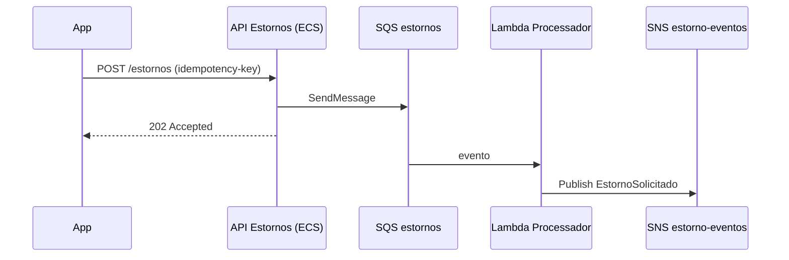

# Desenho técnico (SDD)

O SDD aprovado vira plano: chega ao dev anexado à história e alimenta o `refinamento.yaml` (`definition-of-ready`).

> **A definir pela empresa:** modelo oficial de SDD. Enquanto não houver, use a estrutura abaixo (template `sdd.md` do Nexo).

## Estrutura
```markdown
# SDD: <feature>
## 1. Contexto e objetivo (link para discovery e spec)
## 2. Requisitos que dimensionam a solução (volume, pico, tempos, disponibilidade)
## 3. Visão geral
   - C4 nível 1 (contexto) e nível 2 (contêineres) em Mermaid
## 4. Componentes
| Componente | Tipo (Lambda, ECS, SQS, SNS, Kafka, banco) | Responsabilidade | Dono |
## 5. Fluxos
   - Diagrama de sequência do fluxo principal e dos erros relevantes
## 6. Contratos (APIs e eventos) — ver contratos-de-api-e-eventos
## 7. Dados — modelo, classe (dados-e-lgpd), retenção, migração
## 8. Resiliência — timeouts, retry, idempotência, DLQ (resiliencia-no-desenho)
## 9. Segurança — ameaças e controles (modelagem-de-ameacas), IAM
## 10. Observabilidade — logs, métricas, traces, alarmes, SLOs
## 11. Performance — metas e como serão testadas (testes-de-carga)
## 12. Deploy e rollback — estratégia por ambiente, feature flag, GMUD
## 13. Custo estimado de operação (AWS)
## 14. Decisões (ADRs) e alternativas descartadas
## 15. Riscos e pontos em aberto
```

## Exemplo de diagrama


## Regras
- Todo componente novo tem dono, alarme e custo estimado.
- Toda integração assíncrona tem DLQ, política de retry e idempotência descritas.
- Toda decisão com alternativa relevante vira ADR (`decisoes-de-arquitetura-adr`).
- Escolha de serviço AWS justificada pelo guia `arquitetura-aws-eventos`.
- O SDD não repete a spec: referencia regras por id (RN-x, AC-x).
- Diagramas em Mermaid dentro do markdown (versionados com o código).

## Checklist de aprovação
- [ ] Números do negócio refletidos nas metas técnicas
- [ ] Fluxo principal e de erro desenhados
- [ ] Contratos definidos
- [ ] Dados classificados e retenção definida
- [ ] Segurança, observabilidade, performance e deploy preenchidos
- [ ] ADRs para as decisões relevantes
