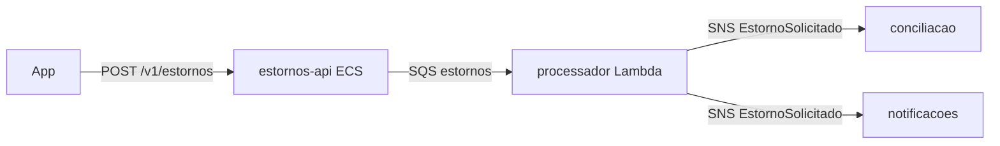

# Documentação viva

O agente **writer** atualiza a documentação a cada história concluída (e sob demanda em repositórios existentes), a partir de fontes verificáveis: código, contratos, SDD, ADRs, refinamento, grafo do Nexo e histórico de mudanças. Ele escreve **só documentação**, nunca código, e cita a fonte de cada afirmação.

## Estrutura no repositório (`docs/`)
| Arquivo | Conteúdo | Fonte principal |
|---|---|---|
| `README.md` (raiz) | O que é, como rodar, testar e fazer deploy | código, esteira |
| `docs/arquitetura.md` | Visão C4 (contexto e contêineres), componentes AWS, fluxos principais | SDD, Terraform, código |
| `docs/servicos.md` | Catálogo: cada Lambda, serviço ECS, fila, tópico, banco — responsabilidade, dono, alarmes | Terraform, código |
| `docs/eventos.md` | Eventos publicados e consumidos, versão, produtor, consumidores | `contracts/`, código |
| `docs/apis.md` | Endpoints, autenticação, erros, links para o OpenAPI | `contracts/` |
| `docs/relacionamentos.md` | Quem este sistema chama e quem o chama; dependências entre repositórios e times | código, contratos, grafo (`nexo graph`) |
| `docs/dominio.md` | Resumo do glossário e regras do contexto (espelha `dominio-<produto>`) | spec, código |
| `docs/adr/README.md` | Índice das ADRs com status | `docs/adr/` |
| `docs/runbook.md` | Operação (`runbook-e-operacao`) | alarmes, procedimentos |
| `docs/historico.md` | O que mudou por entrega (história, data, PR, decisão relevante) | backlog, PRs |

## Relacionamentos (diagrama obrigatório)

- Cada seta com o meio (HTTP, SQS, SNS, Kafka) e o contrato; cada nó com o dono.

## Regras de escrita
- Fatos verificáveis com a fonte (caminho do arquivo, ADR, PR); nada inventado. Se não encontrou a informação, escreva "não identificado" e abra pergunta ao tech lead.
- Atualize a seção afetada; não reescreva documentos inteiros sem necessidade.
- Português do Brasil, frases curtas, termos do glossário; diagramas em Mermaid.
- Sem segredos, dados pessoais, ARNs com número de conta de produção quando a política proibir, ou detalhes que facilitem ataque.
- Mudança de documentação vai no mesmo PR da história (ou em PR próprio do writer, marcado `docs`).

## Base de conhecimento no cérebro
Ao fim de cada feature, o writer propõe no cérebro (`nexo brain propose`, sempre por PR revisado) um resumo em `knowledge/<produto>/<servico>.md`:
- o que o serviço faz, eventos e APIs, relacionamentos, decisões importantes e lições da entrega;
- assim os agentes de outros squads encontram o serviço pelo `search_brain`/`nexo ask` e o grafo liga o conhecimento aos arquivos.

## Checklist a cada história
- [ ] Docs afetados atualizados (serviços, eventos, APIs, relacionamentos, runbook)
- [ ] ADR nova no índice
- [ ] Histórico com a entrega
- [ ] Nada sem fonte
- [ ] Resumo para o cérebro proposto (fim da feature)
